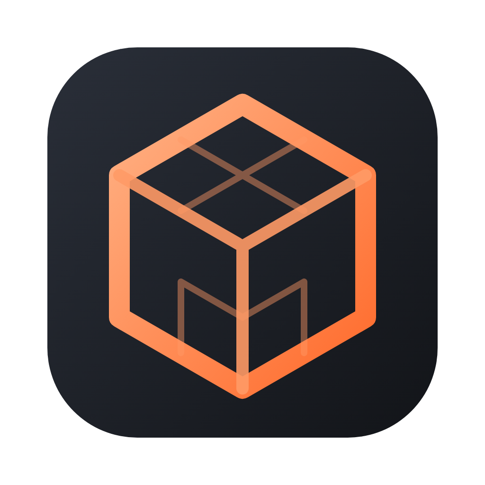
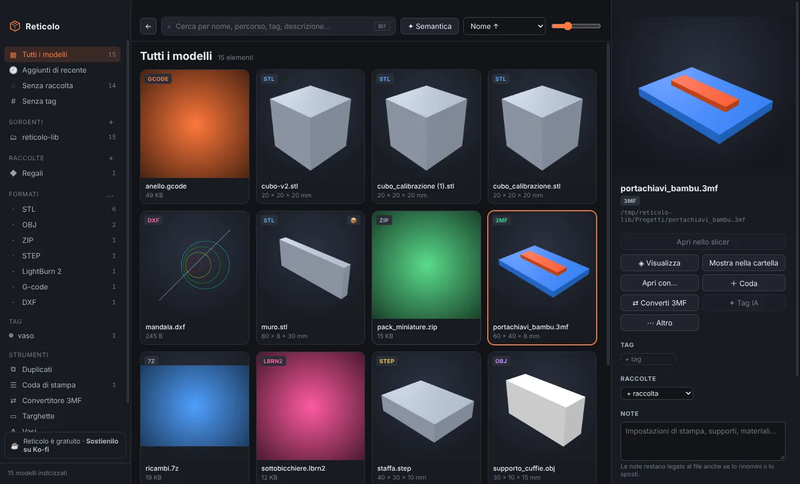
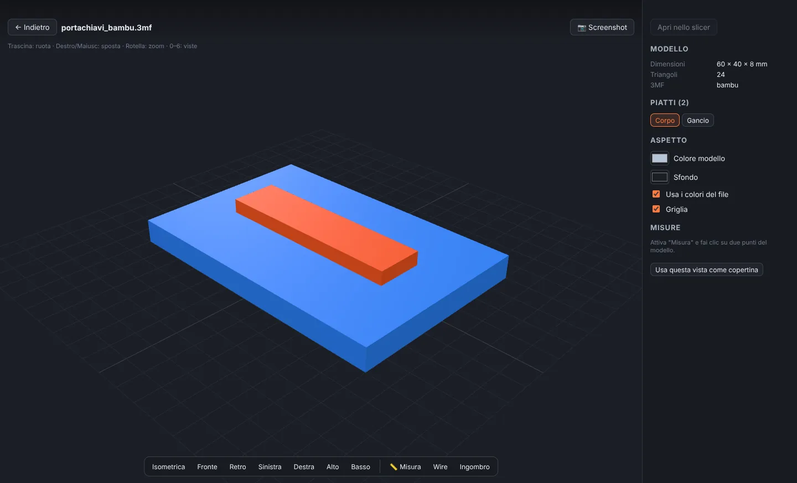
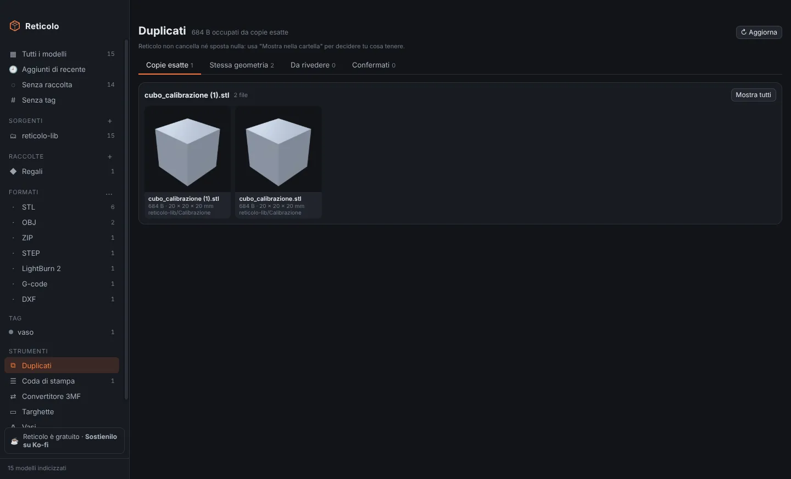
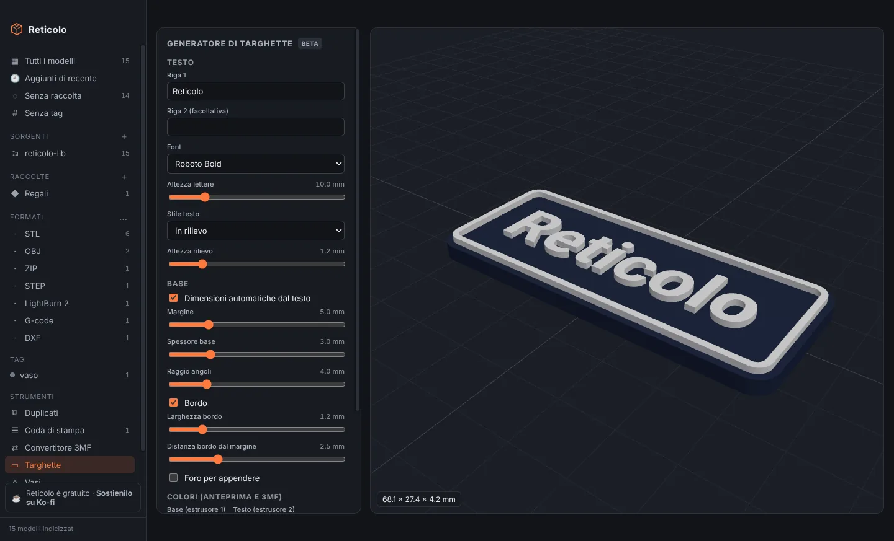
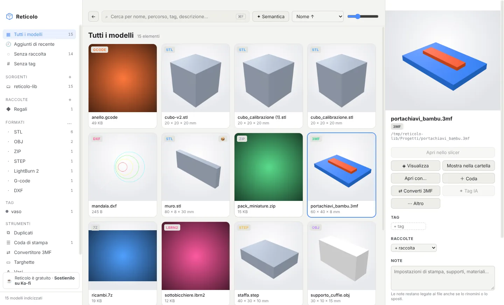

<p align="center"></p>

<h1 align="center">Reticolo</h1>

<p align="center"><b>Il gestore locale e gratuito per le tue librerie di modelli 3D.</b><br>
Stampa 3D, laser e CNC · macOS (Apple Silicon) e Windows (x64)</p>

<p align="center">
  <a href="https://github.com/filippocobelli/reticolo/releases/latest">Scarica</a> ·
  <a href="https://lab.cobelli.uk/reticolo/it/">Sito</a> ·
  <a href="https://ko-fi.com/filippocobelli">Sostieni su Ko-fi</a> ·
  <a href="README.md">English</a>
</p>



Reticolo raccoglie in un'unica libreria tutti i modelli che hai sparsi tra cartelle, dischi esterni e NAS: ne genera le miniature, li apre in un visualizzatore 3D e ti permette di cercarli, etichettarli e mandarli allo slicer in un clic.

Tutto avviene **sul tuo computer**: non c'è un account, nessun file viene caricato online e Reticolo **non sposta, non rinomina e non modifica mai** i tuoi file.

Reticolo è **gratuito**. Se ti è utile, puoi [offrirmi un caffè su Ko-fi](https://ko-fi.com/filippocobelli).

---

## Indice

- [Funzioni](#funzioni)
- [Formati supportati](#formati-supportati)
- [Scaricare e installare](#scaricare-e-installare)
- [Guida rapida](#guida-rapida)
- [Scorciatoie da tastiera](#scorciatoie-da-tastiera)
- [Intelligenza artificiale (facoltativa)](#intelligenza-artificiale-facoltativa)
- [Privacy e dati](#privacy-e-dati)
- [Compilare dal codice](#compilare-dal-codice)
- [Struttura del progetto](#struttura-del-progetto)
- [Come è fatto](#come-è-fatto)
- [Sostenere il progetto](#sostenere-il-progetto)
- [Licenza](#licenza)

## Funzioni

### Libreria
- **Sorgenti multiple**: cartelle locali, dischi esterni e condivisioni di rete (NAS). Le cartelle vengono sorvegliate e la libreria si aggiorna da sola quando aggiungi o cambi un file; per le unità di rete c'è il controllo periodico.
- **Miniature automatiche**: quelle salvate dentro i file (3MF, G-code, LightBurn…) quando esistono, altrimenti generate con un rendering 3D.
- **Archivi aperti come cartelle**: ZIP, RAR, 7Z, TAR e TGZ vengono letti senza estrarli, e i modelli che contengono compaiono nella libreria come gli altri.
- **Due modi di navigare**: tutta la libreria con filtri (formato, sorgente, tag, raccolta) oppure la struttura delle cartelle, con il percorso in alto.
- **File di accompagnamento**: foto, video, PDF e note che stanno nella stessa cartella di un modello compaiono nella sua scheda.

### Organizzare
- **Tag** con colori, **raccolte** che raggruppano i modelli senza spostarli e **note** libere. Si trascinano i modelli sulla barra laterale per aggiungerli a una raccolta, a un tag o alla coda di stampa.
- **Le note e i tag seguono il file**: se lo rinomini o lo sposti, Reticolo lo riconosce dal contenuto e conserva tutto.
- Viste **Senza raccolta**, **Senza tag** e **Aggiunti di recente**.
- **Nascondi**: seleziona file, archivi o intere cartelle che non ti interessano e toglili dalla libreria (tasto **H**). Un archivio nascosto nasconde anche il suo contenuto, e la scelta resta valida dopo le nuove scansioni. Li ritrovi nella vista **Nascosti**.
- **Copertine**: puoi usare come anteprima una foto, un'immagine della stessa cartella o la vista corrente del visualizzatore.

### Cercare
- **Ricerca istantanea** mentre scrivi: nome, percorso, tag, note e descrizione generata dall'IA. Con `-parola` escludi un termine.
- **Ricerca semantica** (facoltativa): descrivi cosa cerchi a parole ("supporto per cuffie da scrivania").
- **Scorciatoia globale** (predefinita ⌘/Ctrl + Maiusc + M) per portare Reticolo in primo piano da qualsiasi app.

### Visualizzatore 3D

- Rotazione, spostamento e zoom; **sette viste** (isometrica, fronte, retro, sinistra, destra, alto, basso).
- **Misure punto a punto** con ΔX, ΔY e ΔZ, ingombro del modello, wireframe.
- **Colori** del modello e dello sfondo personalizzabili, oppure i colori del file.
- **Screenshot PNG** e "usa questa vista come copertina".
- **Progetti multi-piatto** di Bambu Studio e OrcaSlicer, caricati un piatto alla volta.
- **Assiemi STEP** con l'elenco dei componenti, che puoi mostrare, nascondere e inquadrare.
- **Anteprima del G-code** per layer, con i percorsi colorati per tipo.
- Anteprima di immagini, video, PDF e file di testo.

### Duplicati

- **Copie esatte** (stesso contenuto), **stessa geometria** (anche se il modello è stato spostato o salvato in un altro formato) e **probabili duplicati** da rivedere tu, con "sono duplicati" o "sono diversi".
- Reticolo non cancella niente: ti mostra dove sono le copie e decidi tu.

### Stampa
- **Rileva 23 slicer** installati, FDM e resina: PrusaSlicer, Bambu Studio, OrcaSlicer, UltiMaker Cura, SuperSlicer, Creality Print, ElegooSlicer, Anycubic Slicer Next, QIDI Studio, Snapmaker Orca, FlashPrint, ideaMaker, Simplify3D, Lychee, CHITUBOX, VoxelDance Tango, Photon Workshop, HALOT BOX e altri. Puoi aggiungerne uno a mano.
- **Apri nello slicer** preferito o in quello che scegli, anche per più file insieme; oppure **trascina** i modelli direttamente nella finestra dello slicer.
- **Coda di stampa**: tempi e filamento letti in automatico da G-code e 3MF slicati, copie, materiale, colore, note, ordine a trascinamento, totali. Esportazione della checklist in Markdown o CSV. Reticolo non comunica con le stampanti.

### Strumenti (beta)

- **Convertitore 3MF** tra Bambu Studio, OrcaSlicer, PrusaSlicer e 3MF generico: mantiene piatti, colori ed estrusori; con PrusaSlicer crea un file per ogni piatto. L'originale non viene mai modificato.
- **Generatore di targhette**: una o due righe di testo, cinque font, testo in rilievo o inciso, bordo, foro, due colori. Esporta in STL o 3MF.
- **Generatore di vasi**: profilo, lati, torsione, onde; mesh chiusa pronta per la modalità vaso. Esporta in STL o 3MF.

### Aspetto

- **Tema scuro, chiaro o automatico** (segue il sistema).
- **Colore d'accento** a scelta tra otto, oppure personalizzato.

### Backup
- Salva tag, raccolte, note, copertine, elementi nascosti, coda di stampa e revisioni dei duplicati in un unico file.
- **Backup automatico** giornaliero o settimanale, con il numero di copie da conservare.
- Al ripristino i modelli vengono riconosciuti anche se nel frattempo li hai rinominati o spostati.

## Formati supportati

| Tipo | Formati |
|---|---|
| Modelli 3D | STL, 3MF, OBJ, FBX, STEP/STP, 3DM (anteprima parziale), Lychee LYS (sperimentale), Fusion F3D/F3Z, G-code, bgcode |
| Mesh | GLB, PLY; glTF solo nella ricerca |
| Archivi | ZIP, RAR, 7Z, TAR, TAR.GZ, TGZ (letti senza estrarli) |
| Laser e CNC | xTool XCS/XS, LightBurn LBRN/LBRN2, DXF, DWG (anteprima salvata nel file) |
| Accompagnamento | PNG, JPG, WEBP, GIF, BMP, SVG, MP4, MOV, WEBM, PDF, TXT, Markdown |

## Scaricare e installare

Scarica l'ultima versione da **[Releases](https://github.com/filippocobelli/reticolo/releases/latest)**:

- **macOS** (Apple Silicon, macOS 12 o successivo): `Reticolo-mac-arm64.dmg`
- **Windows** (x64, Windows 10 o 11): `Reticolo-win-x64.exe`

### macOS
1. Apri il `.dmg` e trascina Reticolo in **Applicazioni**.
2. L'app non è firmata con un certificato Apple Developer, quindi al primo avvio macOS la blocca. Apri il **Terminale** e lancia una volta:
   ```bash
   xattr -cr /Applications/Reticolo.app
   ```
   In alternativa: Impostazioni di Sistema → Privacy e sicurezza → **Apri comunque**.

### Windows
1. Avvia `Reticolo-win-x64.exe` e segui l'installazione.
2. Se compare l'avviso di SmartScreen: **Ulteriori informazioni** → **Esegui comunque**.

## Guida rapida

1. **Aggiungi una cartella**: dalla schermata iniziale, dal **+** accanto a "Sorgenti" oppure trascinando una cartella nella finestra. La scansione parte subito e le miniature arrivano poco dopo.
2. **Cerca e filtra** con la barra in alto o dalla barra laterale (formati, tag, raccolte).
3. **Seleziona** un modello per vedere i dettagli a destra; **doppio clic** o **Spazio** per aprirlo nel visualizzatore.
4. **Organizza**: aggiungi tag e note nel pannello a destra, trascina i modelli su una raccolta, premi **H** per nascondere quello che non ti serve.
5. **Stampa**: "Apri in …" manda il file allo slicer preferito; "＋ Coda" lo aggiunge alla coda di stampa.
6. In **Impostazioni** trovi tema e colore, sorgenti, slicer, intelligenza artificiale e backup.

## Scorciatoie da tastiera

| Tasto | Azione |
|---|---|
| ⌘/Ctrl + F | Cerca |
| ⌘/Ctrl + A | Seleziona tutto |
| ⌘/Ctrl o Maiusc + clic | Selezione multipla |
| Spazio / Invio | Apri nel visualizzatore |
| ← → | Elemento precedente / successivo |
| H | Nascondi o mostra di nuovo la selezione |
| Esc | Annulla la selezione / chiudi il visualizzatore |
| ⌘/Ctrl + Maiusc + M | Porta Reticolo in primo piano (globale, modificabile) |
| **Nel visualizzatore** | |
| 0 · 1–6 | Vista isometrica · fronte, retro, sinistra, destra, alto, basso |
| M | Misura |
| W | Wireframe |

## Intelligenza artificiale (facoltativa)

Reticolo può generare **tag e una descrizione** per ogni modello partendo dalla sua miniatura, e permettere la **ricerca semantica**. Non è attiva di default e parte **solo quando la avvii tu**, con la tua chiave.

| Provider | Tag e descrizioni | Ricerca semantica |
|---|---|---|
| OpenRouter | sì | sì |
| OpenAI | sì | sì |
| Anthropic | sì | — |
| Google Gemini | sì | — |
| Ollama (locale, gratuito) | sì | sì |
| Codex CLI (piano ChatGPT) | sì | — |

Configurazione: **Impostazioni → Intelligenza artificiale**. Le chiavi sono salvate cifrate con il portachiavi del sistema. Al provider vengono inviati solo la miniatura, il nome del file e la cartella.

## Privacy e dati

- Nessun account, nessuna telemetria, nessun caricamento online.
- I tuoi file vengono solo letti.
- I dati di Reticolo (database, miniature, copertine, backup) stanno in:
  - macOS: `~/Library/Application Support/Reticolo`
  - Windows: `%APPDATA%\Reticolo`
- Gli unici collegamenti a internet sono quelli dell'IA, se la attivi, e i link che apri tu (sito, Ko-fi, GitHub).

## Compilare dal codice

Serve **Node.js 22** o successivo.

```bash
git clone https://github.com/filippocobelli/reticolo.git
cd reticolo
npm install
npm run dev        # compila l'interfaccia e avvia l'app
npm test           # test dei moduli
npm run dist:mac   # su un Mac → release/Reticolo-mac-arm64.dmg
npm run dist:win   # su Windows → release/Reticolo-win-x64.exe
```

### Build automatiche (GitHub Actions)
Il workflow `.github/workflows/build.yml` compila il `.dmg` e l'`.exe`:
- **a mano**: Actions → Build → *Run workflow*. Gli installer restano tra gli artefatti per 3 giorni.
- **come release**: Actions → Build → *Run workflow* con "Pubblica una release" spuntato pubblica la release `v` + la versione di `package.json`, con i due installer (lo stesso fa il push di un tag `v*`).

## Struttura del progetto

```
electron/            processo principale (Node.js)
  main.js            avvio, finestre, protocollo rtc:// per file e miniature
  db.js              database SQLite (node:sqlite, nessun modulo nativo)
  scanner.js         scansione, impronte dei file, rinomini, sorveglianza cartelle
  archives.js        lettura di ZIP, RAR, 7Z, TAR senza estrarre
  extract.js         miniature e metadati incorporati (3MF, G-code, LightBurn, DWG…)
  thumbs.js          coda delle miniature e finestra di rendering
  library.js         libreria, tag, raccolte, note, elementi nascosti
  duplicates.js      copie esatte, stessa geometria, probabili duplicati
  threemf.js         lettura/scrittura 3MF, convertitore, esportazione mesh
  slicers.js         rilevamento e apertura degli slicer
  ai.js              provider IA, tag, descrizioni, embeddings
  queue.js           coda di stampa
  backup.js          backup e ripristino
src/                 interfaccia (React + Vite)
  components/        schermate e pannelli
  viewer/            caricamento modelli, scena three.js, G-code, DXF
  worker.js          finestra nascosta che genera le miniature
  theme.js           tema chiaro/scuro e colori d'accento
test/                test dei moduli e test end-to-end
docs/                sito del progetto (lab.cobelli.uk/reticolo) e immagini del README
```

Il test end-to-end (`npm run test:e2e`) crea una libreria di prova con tutti i formati principali, avvia l'app vera e verifica scansione, miniature, duplicati, ricerca, elementi nascosti, coda, backup, conversione 3MF e temi.

## Come è fatto

Non sono un programmatore. Ho tante idee e le realizzo con l'intelligenza artificiale (**Claude**): io decido cosa deve fare e lo provo, l'AI scrive il codice. Segnalazioni e suggerimenti sono benvenuti nelle [issue](https://github.com/filippocobelli/reticolo/issues).

Componenti open source usati: Electron, React, three.js, occt-import-js (STEP), rhino3dm (3DM), dxf-parser, fflate, node-unrar-js, 7-Zip, opentype.js e i font Roboto, Bebas Neue, Pacifico (licenza OFL).

## Sostenere il progetto

Reticolo è gratuito e lo resterà. Se ti fa risparmiare tempo, puoi offrirmi un caffè:

<a href="https://ko-fi.com/filippocobelli"><b>☕ ko-fi.com/filippocobelli</b></a>

## Licenza

© 2026 Filippo Cobelli. Reticolo è gratuito da scaricare e usare. Il programma è fornito "così com'è", senza garanzie di alcun tipo.
