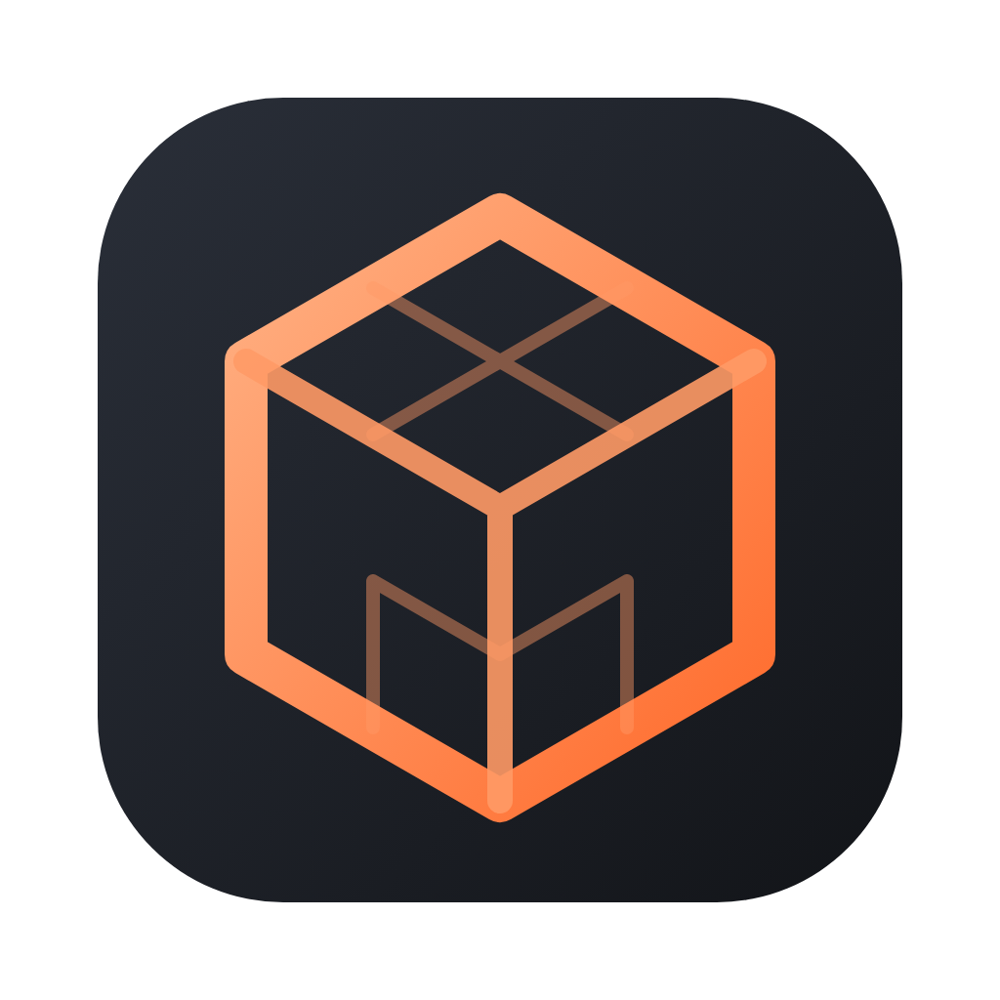
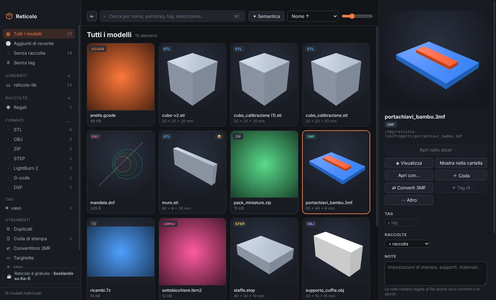
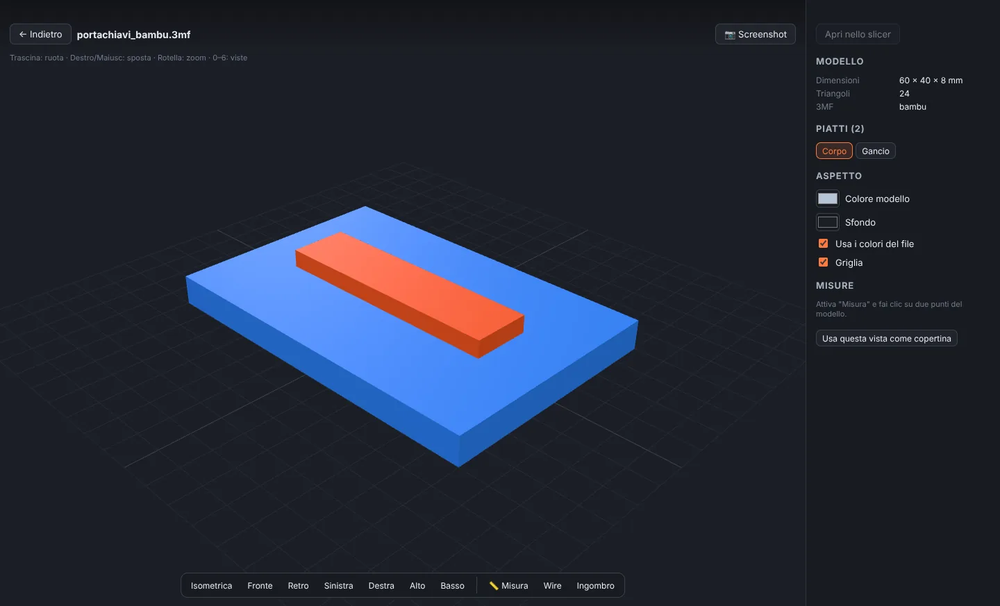
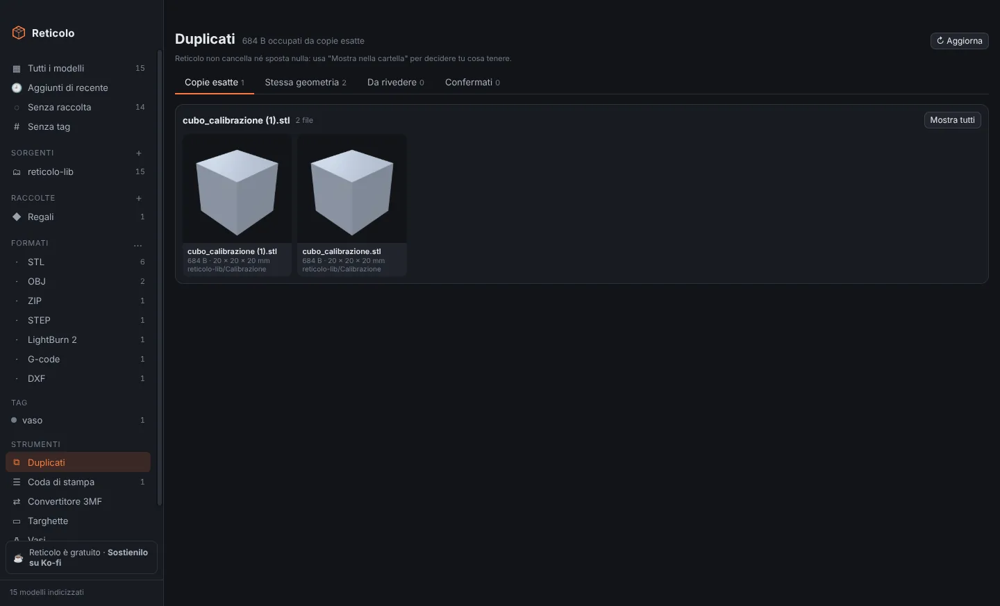
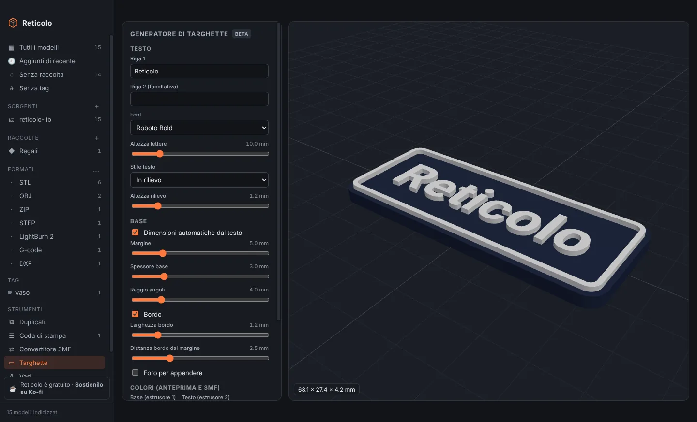
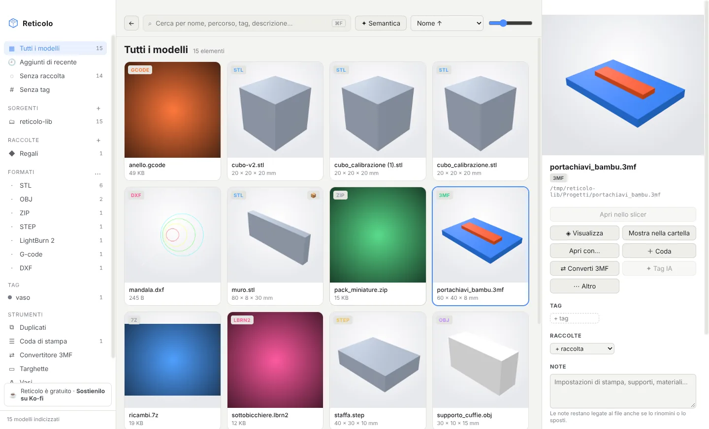

<p align="center"></p>

<h1 align="center">Reticolo</h1>

<p align="center"><b>The free, local manager for your 3D model libraries.</b><br>
3D printing, laser and CNC · macOS (Apple Silicon) and Windows (x64)</p>

<p align="center">
  <a href="https://github.com/filippocobelli/reticolo/releases/latest">Download</a> ·
  <a href="https://lab.cobelli.uk/reticolo/">Website</a> ·
  <a href="https://ko-fi.com/filippocobelli">Support on Ko-fi</a> ·
  <a href="README.it.md">Italiano</a>
</p>



Reticolo gathers every model scattered across your folders, external drives and NAS into a single library: it makes thumbnails, opens models in a 3D viewer and lets you search, tag and send them to your slicer in one click.

Everything happens **on your computer**: there is no account, nothing is uploaded, and Reticolo **never moves, renames or modifies** your files.

Reticolo is **free**. If you find it useful, you can [buy me a coffee on Ko-fi](https://ko-fi.com/filippocobelli).

> The app's interface is currently in Italian.

---

## Contents

- [Features](#features)
- [Supported formats](#supported-formats)
- [Download and install](#download-and-install)
- [Quick start](#quick-start)
- [Keyboard shortcuts](#keyboard-shortcuts)
- [AI (optional)](#ai-optional)
- [Privacy and data](#privacy-and-data)
- [Building from source](#building-from-source)
- [Project structure](#project-structure)
- [How it's made](#how-its-made)
- [Support the project](#support-the-project)
- [License](#license)

## Features

### Library
- **Multiple sources**: local folders, external drives and network shares (NAS). Folders are watched and the library updates itself when you add or change a file; network drives can use periodic polling.
- **Automatic thumbnails**: the ones embedded in the files (3MF, G-code, LightBurn…) when available, otherwise rendered in 3D.
- **Archives browsed like folders**: ZIP, RAR, 7Z, TAR and TGZ are read without extracting them, and the models inside show up in the library like any other.
- **Two ways to browse**: the whole library with filters (format, source, tag, collection), or the folder tree with a breadcrumb.
- **Companion files**: photos, videos, PDFs and notes sitting next to a model appear on its detail panel.

### Organise
- Colour **tags**, **collections** that group models without moving them, and free-form **notes**. Drag models onto the sidebar to add them to a collection, a tag or the print queue.
- **Notes and tags follow the file**: rename or move it and Reticolo recognises it by its content, keeping everything.
- **Not in a collection**, **Untagged** and **Recently added** views.
- **Hide**: select files, archives or whole folders you don't care about and remove them from the library (**H** key). Hiding an archive hides everything inside it, and the choice survives future scans. You'll find them under **Hidden**.
- **Covers**: use a photo, an image from the same folder or the current viewer angle as the preview.

### Search
- **Instant search** as you type: name, path, tags, notes and AI description. Use `-word` to exclude a term.
- **Semantic search** (optional): describe what you're looking for in plain words ("desk headphone stand").
- **Global shortcut** (default ⌘/Ctrl + Shift + M) brings Reticolo to the front from any app.

### 3D viewer

- Orbit, pan and zoom; **seven views** (isometric, front, back, left, right, top, bottom).
- **Point-to-point measurements** with ΔX, ΔY and ΔZ, bounding box, wireframe.
- Custom **model and background colours**, or the file's own colours.
- **PNG screenshots** and "use this view as cover".
- **Multi-plate projects** from Bambu Studio and OrcaSlicer, loaded one plate at a time.
- **STEP assemblies** with the component list: show, hide and frame each part.
- **G-code preview** layer by layer, with paths coloured by type.
- Preview of images, videos, PDFs and text files.

### Duplicates

- **Exact copies** (same content), **same geometry** (even when moved or saved in another format) and **probable duplicates** for you to review with "they're duplicates" or "they're different".
- Reticolo never deletes anything: it shows you where the copies are and you decide.

### Printing
- **Detects 23 installed slicers**, FDM and resin: PrusaSlicer, Bambu Studio, OrcaSlicer, UltiMaker Cura, SuperSlicer, Creality Print, ElegooSlicer, Anycubic Slicer Next, QIDI Studio, Snapmaker Orca, FlashPrint, ideaMaker, Simplify3D, Lychee, CHITUBOX, VoxelDance Tango, Photon Workshop, HALOT BOX and more. You can add one by hand.
- **Open in** your preferred slicer or any other, even several files at once, or **drag** models straight into the slicer window.
- **Print queue**: time and filament read automatically from sliced G-code and 3MF files, copies, material, colour, notes, drag-to-reorder, totals. Export the checklist as Markdown or CSV. Reticolo does not talk to printers.

### Tools (beta)

- **3MF converter** between Bambu Studio, OrcaSlicer, PrusaSlicer and generic 3MF: keeps plates, colours and extruders; for PrusaSlicer it writes one file per plate. The original is never modified.
- **Nameplate generator**: one or two lines of text, five fonts, raised or engraved text, border, hole, two colours. Exports STL or 3MF.
- **Vase generator**: profile, sides, twist, waves; a closed mesh ready for vase mode. Exports STL or 3MF.

### Appearance

- **Dark, light or automatic theme** (follows the system).
- **Accent colour**: eight presets or your own.

### Backup
- Saves tags, collections, notes, covers, hidden items, the print queue and duplicate reviews in a single file.
- **Automatic backup** daily or weekly, keeping as many copies as you choose.
- On restore, models are recognised even if you have renamed or moved them in the meantime.

## Supported formats

| Type | Formats |
|---|---|
| 3D models | STL, 3MF, OBJ, FBX, STEP/STP, 3DM (partial preview), Lychee LYS (experimental), Fusion F3D/F3Z, G-code, bgcode |
| Meshes | GLB, PLY; glTF searchable only |
| Archives | ZIP, RAR, 7Z, TAR, TAR.GZ, TGZ (read without extracting) |
| Laser and CNC | xTool XCS/XS, LightBurn LBRN/LBRN2, DXF, DWG (embedded preview) |
| Companions | PNG, JPG, WEBP, GIF, BMP, SVG, MP4, MOV, WEBM, PDF, TXT, Markdown |

## Download and install

Get the latest version from **[Releases](https://github.com/filippocobelli/reticolo/releases/latest)**:

- **macOS** (Apple Silicon, macOS 12 or later): `Reticolo-mac-arm64.dmg`
- **Windows** (x64, Windows 10 or 11): `Reticolo-win-x64.exe`

### macOS
1. Open the `.dmg` and drag Reticolo to **Applications**.
2. The app isn't signed with an Apple Developer certificate, so macOS blocks it on first launch. Open **Terminal** and run once:
   ```bash
   xattr -cr /Applications/Reticolo.app
   ```
   Alternatively: System Settings → Privacy & Security → **Open Anyway**.

### Windows
1. Run `Reticolo-win-x64.exe` and follow the installer.
2. If SmartScreen appears: **More info** → **Run anyway**.

## Quick start

1. **Add a folder**: from the welcome screen, the **+** next to "Sorgenti" (Sources), or by dropping a folder onto the window. Scanning starts right away and thumbnails follow shortly.
2. **Search and filter** with the top bar or the sidebar (formats, tags, collections).
3. **Select** a model to see its details on the right; **double-click** or press **Space** to open the viewer.
4. **Organise**: add tags and notes in the right panel, drag models onto a collection, press **H** to hide what you don't need.
5. **Print**: "Apri in …" sends the file to your preferred slicer; "＋ Coda" adds it to the print queue.
6. **Impostazioni** (Settings) holds theme and colour, sources, slicers, AI and backup.

## Keyboard shortcuts

| Key | Action |
|---|---|
| ⌘/Ctrl + F | Search |
| ⌘/Ctrl + A | Select all |
| ⌘/Ctrl or Shift + click | Multiple selection |
| Space / Enter | Open in the viewer |
| ← → | Previous / next item |
| H | Hide or unhide the selection |
| Esc | Clear selection / close the viewer |
| ⌘/Ctrl + Shift + M | Bring Reticolo to the front (global, configurable) |
| **In the viewer** | |
| 0 · 1–6 | Isometric · front, back, left, right, top, bottom |
| M | Measure |
| W | Wireframe |

## AI (optional)

Reticolo can generate **tags and a description** for each model from its thumbnail, and enable **semantic search**. It is off by default and runs **only when you start it**, with your own key.

| Provider | Tags and descriptions | Semantic search |
|---|---|---|
| OpenRouter | yes | yes |
| OpenAI | yes | yes |
| Anthropic | yes | — |
| Google Gemini | yes | — |
| Ollama (local, free) | yes | yes |
| Codex CLI (ChatGPT plan) | yes | — |

Set it up in **Impostazioni → Intelligenza artificiale**. Keys are stored encrypted with the system keychain. Only the thumbnail, file name and folder are sent to the provider.

## Privacy and data

- No account, no telemetry, no uploads.
- Your files are only ever read.
- Reticolo's own data (database, thumbnails, covers, backups) lives in:
  - macOS: `~/Library/Application Support/Reticolo`
  - Windows: `%APPDATA%\Reticolo`
- The only internet connections are the AI calls, if you enable them, and the links you open yourself (website, Ko-fi, GitHub).

## Building from source

Requires **Node.js 22** or later.

```bash
git clone https://github.com/filippocobelli/reticolo.git
cd reticolo
npm install
npm run dev        # builds the UI and starts the app
npm test           # module tests
npm run dist:mac   # on a Mac → release/Reticolo-mac-arm64.dmg
npm run dist:win   # on Windows → release/Reticolo-win-x64.exe
```

### Automatic builds (GitHub Actions)
The `.github/workflows/build.yml` workflow builds the `.dmg` and the `.exe`:
- **manually**: Actions → Build → *Run workflow*. Installers are kept as artifacts for 3 days.
- **as a release**: Actions → Build → *Run workflow* with "Pubblica una release" ticked publishes release `v` + the version in `package.json`, with both installers (a `v*` tag push does the same).

## Project structure

```
electron/            main process (Node.js)
  main.js            startup, windows, rtc:// protocol for files and thumbnails
  db.js              SQLite database (node:sqlite, no native modules)
  scanner.js         scanning, file fingerprints, renames, folder watching
  archives.js        reads ZIP, RAR, 7Z, TAR without extracting
  extract.js         embedded thumbnails and metadata (3MF, G-code, LightBurn, DWG…)
  thumbs.js          thumbnail queue and render window
  library.js         library, tags, collections, notes, hidden items
  duplicates.js      exact copies, same geometry, probable duplicates
  threemf.js         3MF read/write, converter, mesh export
  slicers.js         slicer detection and launching
  ai.js              AI providers, tags, descriptions, embeddings
  queue.js           print queue
  backup.js          backup and restore
src/                 user interface (React + Vite)
  components/        screens and panels
  viewer/            model loading, three.js scene, G-code, DXF
  worker.js          hidden window that renders thumbnails
  theme.js           light/dark theme and accent colours
test/                module tests and end-to-end test
docs/                project website (lab.cobelli.uk/reticolo) and README images
```

The end-to-end test (`npm run test:e2e`) builds a sample library with all the main formats, launches the real app and checks scanning, thumbnails, duplicates, search, hidden items, the queue, backup, 3MF conversion and themes.

## How it's made

I'm not a programmer. I have plenty of ideas and build them with AI (**Claude**): I decide what they should do and test them, the AI writes the code. Bug reports and suggestions are welcome in the [issues](https://github.com/filippocobelli/reticolo/issues).

Open-source components: Electron, React, three.js, occt-import-js (STEP), rhino3dm (3DM), dxf-parser, fflate, node-unrar-js, 7-Zip, opentype.js and the Roboto, Bebas Neue and Pacifico fonts (OFL).

## Support the project

Reticolo is free and will stay free. If it saves you time, you can buy me a coffee:

<a href="https://ko-fi.com/filippocobelli"><b>☕ ko-fi.com/filippocobelli</b></a>

## License

© 2026 Filippo Cobelli. Reticolo is free to download and use. The software is provided "as is", without warranty of any kind.
